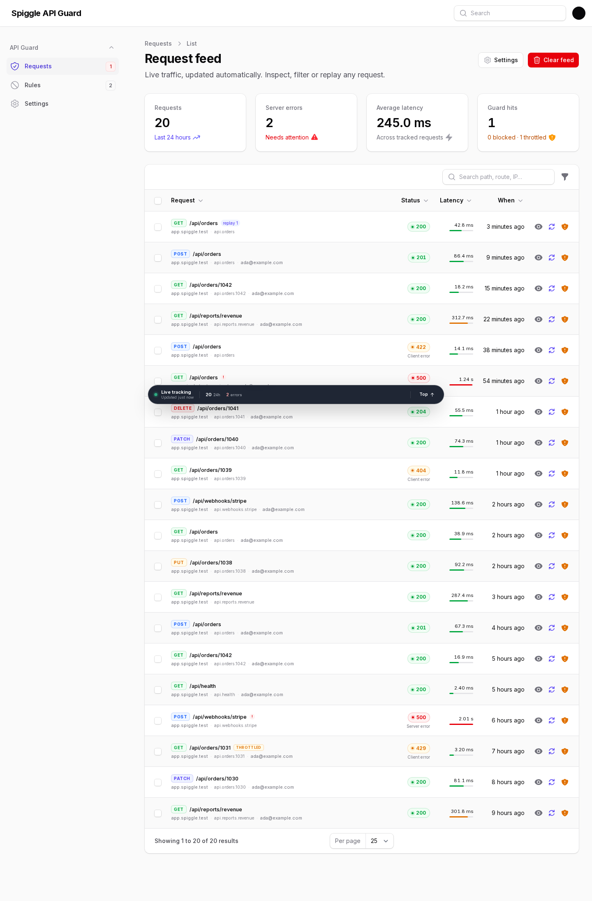
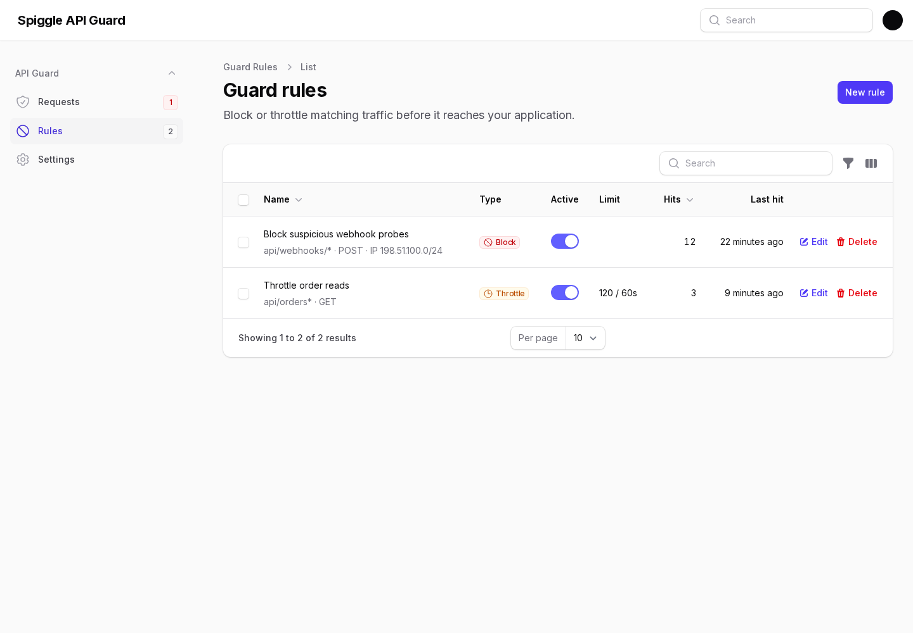
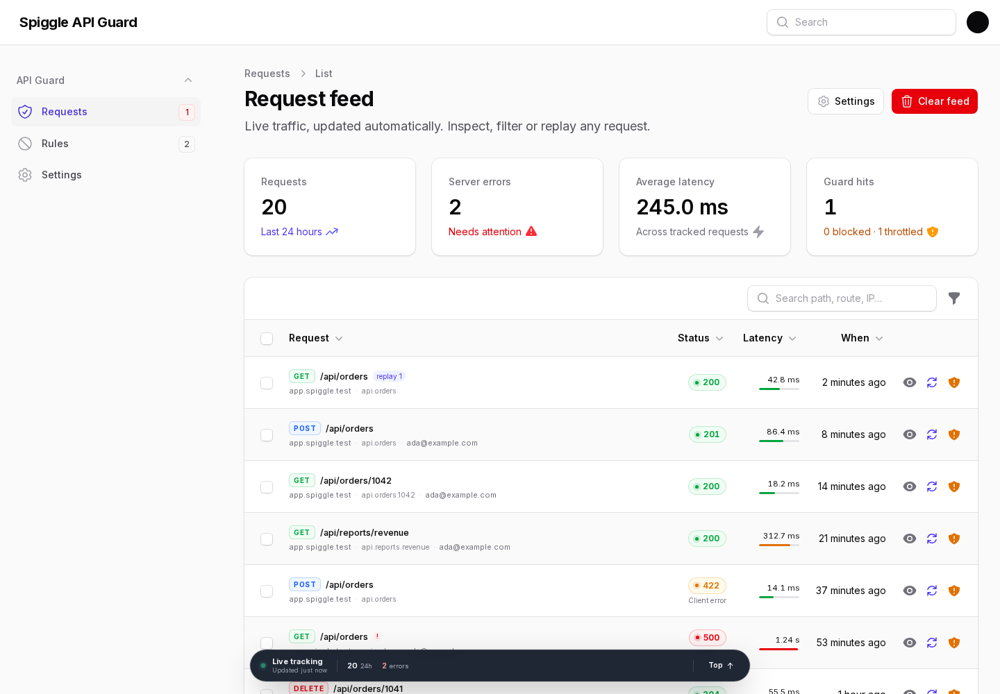
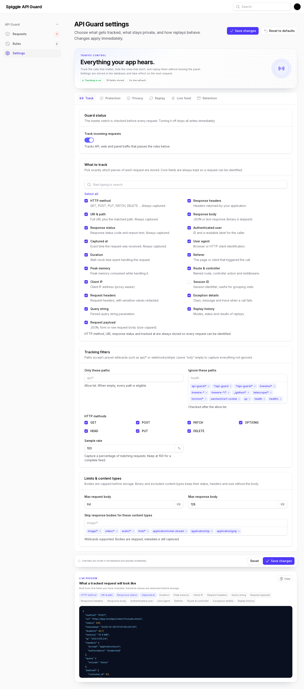

# Spiggle API Guard

**Track, inspect, filter, replay, throttle and block every API request in your Filament panel or Laravel app — without leaving the admin UI.**



API Guard listens to the global HTTP stack, records the request and response data you choose, and turns the feed into a live, searchable debugging workspace. Simulated replays explain exactly what a request will do before anything runs. Live replays can even roll back database writes afterwards.

Built and tested against **Filament 4 and Filament 5**. See [`docs/PLAN.md`](docs/PLAN.md) for the architecture, replay design and full verification matrix.

Repository: [skillbobby/Spiggle-API-Guard](https://github.com/skillbobby/Spiggle-API-Guard)

## Features

- **Track everything that matters** — method, URI, route, controller, status, duration, memory, request/response headers, query string, JSON/form payloads, response body, IP, user, user agent, referer, session and exceptions.
- **Choose the fields** — a checklist in the panel decides exactly what is stored. Core identifiers are always kept so the feed stays navigable.
- **Privacy first** — authorization headers, cookies, CSRF tokens and configurable body/query keys are redacted before storage. Payload and response sizes are capped.
- **Powerful tracking rules** — allow/ignore paths with wildcards, method filters, sampling, static asset and content-type exclusion, and separate request/response limits.
- **Live by default** — the table, stats and bottom status dock poll in the background. New traffic appears without refreshing; new errors raise a toast; a loader runs while updates are in flight.
- **Designed for triage** — method and status badges, latency bars, filters for errors/slow/replayed requests, a date range filter and global search.
- **Deep inspection** — request payload, response body, headers, middleware, route, user and exception details in one tabbed view with JSON highlighting and copy buttons.
- **Replay console** — simulated mode resolves the route and shows auth, side effects and warnings without executing. Live mode sends the request through the real HTTP kernel, optionally rolling back database writes.
- **Retention built in** — daily pruning by age and total record cap, plus an on-demand `api-guard:prune` command with dry-run support.
- **Safe by default** — replay guardrails for allowed methods/hosts, recursion protection, guard self-exclusion and configurable access control.

## Requirements

| Requirement | Version |
| --- | --- |
| PHP | 8.2+ |
| Laravel | 11, 12 or 13 |
| Filament | 4.x or 5.x |
| Database | MySQL, PostgreSQL or SQLite |

## Installation

```bash
composer require spiggle/filament-api-guard

# Publishes config/migrations, publishes Filament assets and optionally migrates
php artisan api-guard:install --migrate
```

> **Developing from this repository:** the package lives in `filament-api-guard/`. Add a path repository and require the dev branch until the package is tagged on Packagist:
>
> ```bash
> composer config repositories.api-guard path ./filament-api-guard
> composer require spiggle/filament-api-guard:@dev
> ```

If you prefer to do it manually:

```bash
php artisan vendor:publish --tag=api-guard-config
php artisan vendor:publish --tag=api-guard-migrations
php artisan migrate
php artisan filament:assets
```

Register the plugin in your panel provider:

```php
use Spiggle\ApiGuard\ApiGuardPlugin;

public function panel(Panel $panel): Panel
{
    return $panel
        // ...
        ->plugin(ApiGuardPlugin::make());
}
```

Open **API Guard → Settings** and check the data you want to track.

> Assets are served from `public/css/spiggle/filament-api-guard` and `public/js/spiggle/filament-api-guard`. Run `php artisan filament:assets` after installing or updating the package.

## How tracking works

`Spiggle\ApiGuard\Http\Middleware\CaptureApiRequest` is pushed onto the global HTTP stack. It:

1. Runs your tracking rules before the request reaches the application.
2. Starts a timer and remembers the request state.
3. Lets the application handle the request untouched.
4. Writes the record after the response has been sent (`terminate()`), so observability never slows the response.

The listener is fail-safe: a storage error or missing migration will never break the host application. Set `API_GUARD_LOG_FAILURES=true` (or `log_failures` in config) to log tracking failures.

Guard pages, Livewire update traffic, health checks and static assets are excluded by default to keep the feed useful.

## What gets tracked

The settings page exposes every field as a checklist:

| Group | Fields |
| --- | --- |
| Request | HTTP method, URI & path, query string, request payload, headers, user agent, referer |
| Response | status, duration, response headers, response body, exception details |
| Context | client IP, authenticated user, session ID, timestamp, route/controller/middleware, peak memory, replay history |

**Core fields** (method, URI, status, tracked at) are always retained. Everything else can be toggled at runtime; changes take effect on the next request.

Uploaded files are never stored — only their name, MIME type and size metadata. Binary and configured content types skip body storage while keeping status, headers and size.

## Using the feed

The request feed is designed to stay out of your way:

- **Live dock** — a fixed bottom bar shows whether tracking is live, the last update, 24h total and server error count. It polls on the interval selected in settings (2–60 seconds) and shows a progress loader while fetching.
- **Automatic refresh** — the table and the 24-hour stats refresh on the same interval. No manual reloads.
- **Toasts** — new traffic raises a subtle success toast; new 5xx responses raise a danger toast. Toggle both in **Settings → Live feed**.
- **Search & filters** — search by path, URI, route, caller or IP. Filter by method, status family, date range, slow requests, server errors or replayed requests.
- **Quick actions** — inspect a request or jump straight to its replay console from the row action buttons.
- **Detail view** — Request, Response, Headers, Context and Replays tabs; request/response bodies are syntax-highlighted with copy buttons; cURL export is one click away.

## Replay

Every tracked request has a replay console with two modes.

### Simulated

A simulated replay never executes anything. It:

- Resolves the target against the application's route collection.
- Shows the matched route, controller and middleware.
- Reports whether authentication is required and which user would be restored.
- Flags writes, destructive actions, CSRF-protected routes, throttling, truncated payloads and external hosts.
- Produces a step-by-step plan that is stored in the replay history.

Use this to answer “what would happen if I sent this again?” without risk.

### Live

A live replay dispatches an internal request through the real Laravel HTTP kernel:

- The original authenticated user is restored for the replay.
- The request can be edited first (method, URI, headers, body).
- **Safe mode** wraps execution in a database transaction and rolls it back. Database writes are undone; emails, queued jobs, cache writes and third-party API calls cannot be rolled back.
- Internal replays are marked and excluded from the tracking feed, so they never create feedback loops.
- Replays are blocked for exotic methods, external hosts and guard routes. Configure limits in **Settings → Replay** or `config/api-guard.php`.

The replay result shows status, duration, warnings, the execution plan, whether the transaction was rolled back and the response body.

## Guard rules — block & throttle

**API Guard → Rules** manages the protection policy. Rules match by path (wildcards), HTTP method, client IP (exact, wildcard or CIDR) and authenticated user. Higher priority runs first; a matching block rule wins over throttling.

- **Block** rules return the configured status (403 by default) before the request reaches your route.
- **Throttle** rules use Laravel’s rate limiter, keyed by client IP or authenticated user, and return `429` with `Retry-After` once the limit is exhausted.
- Responses include `X-API-Guard-Action` and `X-API-Guard-Rule`; throttle responses also include `X-RateLimit-Limit` and `X-RateLimit-Remaining`.
- The feed has **Block this request** and **Throttle this request** shortcuts in the row guard menu and the request detail header.
- Guard rule decisions are tracked on the request, shown inline in the feed and under **Context → API Guard decision**.
- Guard rules never apply to the API Guard panel, Livewire update traffic or health endpoints.
- Simulated replays report whether a rule would block or throttle; live replays bypass guard enforcement by default so you can inspect the underlying response. Set `guard.bypass_replays` to `false` to enforce rules during replay.

```php
'guard' => [
    'enabled' => true,
    'block_status' => 403,
    'throttle_status' => 429,
    'block_message' => 'Request blocked by API Guard.',
    'throttle_message' => 'Too many requests. Please retry later.',
    'bypass_replays' => true,
],
```



## Live updates

```php
'live' => [
    'enabled' => true,
    'interval' => 5,             // seconds
    'notify_on_new' => true,
    'notify_on_error' => true,
],
```

The live bar only appears on request feed/detail pages. Settings stays focused on configuration.



## Tracking rules

```php
'only_paths' => [],
'ignore_paths' => [
    'api-guard/*',
    '*/api-guard',
    '*/api-guard/*',
    'livewire/*',
    'livewire-*',
    'livewire-*/*',
    '_ignition/*',
    'telescope/*',
    'horizon/*',
    'sanctum/csrf-cookie',
    'up',
    'health',
    'healthz',
],
'methods' => ['GET', 'HEAD', 'POST', 'PUT', 'PATCH', 'DELETE', 'OPTIONS'],
'sample_rate' => 100,
'ignore_content_types' => ['image/*', 'video/*', 'audio/*', 'font/*', 'application/octet-stream', 'application/zip', 'application/gzip'],
```

Paths support Laravel wildcards (`api/*`, `webhooks/stripe*`). The allow list is evaluated first, then the ignore list. Method names are normalised to uppercase.

## Privacy

Sensitive header names and JSON/query keys are redacted before a record is written (request and response bodies included):

```php
'redact_headers' => [
    'authorization', 'proxy-authorization', 'cookie', 'set-cookie',
    'x-api-key', 'x-auth-token', 'x-csrf-token', 'x-xsrf-token', 'php-auth-pw',
],
'redact_keys' => [
    'password', 'password_confirmation', 'current_password', 'secret', 'token',
    'api_key', 'apikey', 'access_token', 'refresh_token', 'private_key',
    'card_number', 'card_cvc', 'cvv', 'ssn',
],
```

Wildcards are supported (`*_token`, `*_secret`). URI query strings are redacted too; secrets do not leak through the stored URI.

> The guard stores request/response bodies when enabled. Treat its database table with the same care as application logs, apply your own retention policy and restrict access in production.


## Authorization

By default, any authenticated user who can access the Filament panel can use the guard. Restrict it with a gate and/or email allow list:

```php
'authorization' => [
    'gate' => 'viewApiGuard', // Gate::forUser($user)->allows(...)
    'emails' => ['ops@example.com'],
],
```

Enforce it in a service provider:

```php
Gate::define('viewApiGuard', fn (User $user): bool => $user->isAdmin());
```

The resource and settings page both honour the same policy. API tracking itself is independent of panel access.

## Retention

```php
'retention_days' => 14,
'max_records' => 25000,
'schedule_prune' => true,
```

The package schedules `api-guard:prune` daily at 03:15. Run it manually at any time:

```bash
php artisan api-guard:prune --days=7 --max=10000
php artisan api-guard:prune --dry-run
```

Replay history is removed with its parent request.

## Configuration reference

| Key | Default | Purpose |
| --- | --- | --- |
| `enabled` | `true` | Master tracking switch. |
| `register_global_middleware` | `true` | Capture panel, API and web traffic automatically. |
| `only_paths` / `ignore_paths` | `[]` / sensible ignores | Capture allow/deny list. |
| `methods` | GET…OPTIONS | Methods eligible for tracking. |
| `sample_rate` | `100` | Tracking percentage (1–100). |
| `capture` | all fields except session | Stored fields (core fields are forced; session is opt-in). |
| `guard.enabled` | `true` | Enables block and throttle rules. |
| `guard.bypass_replays` | `true` | Replays bypass guard enforcement. |
| `max_payload_kb` | `64` | Request body cap. |
| `max_response_kb` | `128` | Response body cap. |
| `redact_headers` / `redact_keys` | see above | Sensitive value redaction. |
| `retention_days` / `max_records` | `14` / `25000` | Retention policy. |
| `database.rules_table` | `api_guard_rules` | Guard rule storage table. |
| `live.interval` | `5` | Poll interval in seconds. |
| `replay.allow_live` | `true` | Enable live replays. |
| `replay.allowed_methods` | GET…DELETE | Methods a live replay may use. |
| `replay.rollback_by_default` | `true` | Default safe mode for replay UI. |
| `replay.allowed_hosts` | `[]` | Additional hosts permitted as replay targets. |
| `authorization` | any panel user | Gate/email policy. |
| `user_label_attribute` | `email` | Attribute shown as the caller label. |
| `log_failures` | `false` | Log storage failures instead of staying silent. |

Every UI-editable setting is stored in `api_guard_settings`; config values are the defaults. Reset overrides from the settings page at any time.

## Testing

```bash
composer test
```

The suite covers tracking, filtering, blocking, throttling, guard-rule CRUD, replay guard planning, redaction, truncation, exceptions, binary responses, live replay, rollback, auth restoration, settings, pruning and the Filament pages/live bar.

Verified against both supported branches:

| Filament | Livewire | Laravel | Result |
| --- | --- | --- | --- |
| 5.11 | 4.4 | 12.70 | 62 tests / 315 assertions |
| 4.16 | 3.8 | 12.70 | 62 tests / 315 assertions |

### Workbench demo

A small workbench app is included for local UI work:

```bash
php vendor/bin/testbench migrate:fresh --seed --seeder='Workbench\Database\Seeders\DatabaseSeeder'
php vendor/bin/testbench filament:assets
php vendor/bin/testbench serve --port=8001
```

Open [http://127.0.0.1:8001/admin/api-guard/requests](http://127.0.0.1:8001/admin/api-guard/requests). The demo auto-logs in as `ada@example.com` and seeds 20 realistic requests. Demo-only routes live under `/api/*`.



## Security notes

- Live replay executes requests inside your application. Protect the guard with a gate/email list and restrict `replay.allowed_methods` in production.
- Redaction runs before persistence, but request bodies can still contain business data. Use the payload/response caps, narrow the field checklist and prune regularly.
- Replay of web (non-API) routes can fail CSRF checks; the plan warns you before executing.
- The guard UI is served through your panel; no public routes are registered by the package.

## License

MIT © Spiggle. See [LICENSE](LICENSE).

