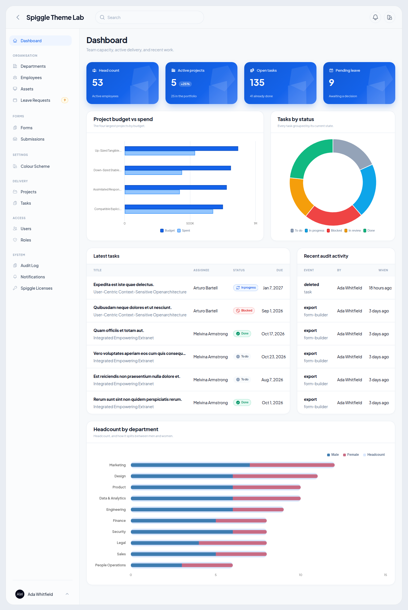
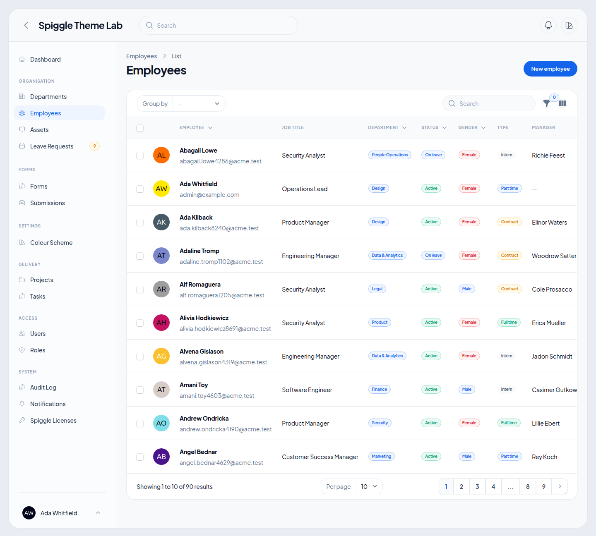
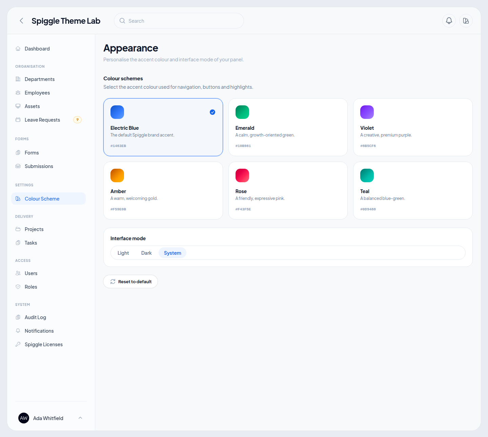
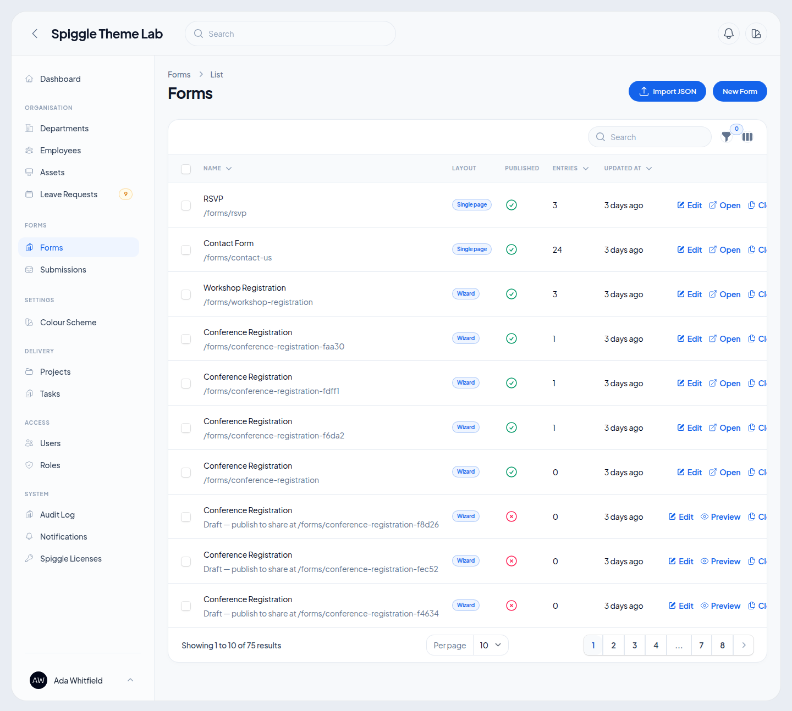

# Spiggle Small Business Theme

A theme that gives panels a settled look: one rounded frame, six colour schemes, and the cards to build a dashboard.

It restyles every screen you already have, including forms, tables, modals and the sign-in page. The stylesheet ships prebuilt, so there is no Node build.

Product page: https://skillbobby.github.io/spiggle/small-business-theme/

**Current version:** 2.4

PHP 8.3+ · Laravel 13 · Filament 5

## Preview

The panel sits on a quiet canvas as a single rounded surface. Sidebar, topbar and content share that frame. Cards, buttons and navigation follow the active scheme.

Click a screenshot to open it full size.

| Dashboard | Employees |
| --- | --- |
| [](docs/preview/dashboard.png) | [](docs/preview/employees.png) |
| Appearance | Forms |
| [](docs/preview/appearance.png) | [](docs/preview/forms.png) |

## Installation

```bash
composer require spiggle/small-business-theme
php artisan filament:assets
```

Register the plugin on the panel:

```php
use Spiggle\Theme\SpiggleThemePlugin;

$panel->plugin(SpiggleThemePlugin::make());
```

That registers the stylesheet, the font, the colour schemes, the switcher and the appearance page.

Your brand name, logo and navigation stay yours:

```php
$panel
    ->brandName('Northwind')
    ->brandLogo(asset('images/logo.svg'))
    ->plugin(SpiggleThemePlugin::make());
```

## Colour schemes

Six schemes ship with the theme: Electric Blue, Emerald, Violet, Amber, Rose and Teal. Each is a full palette, and the active one becomes the panel primary.

Set the default, and drop any scheme you do not want to offer:

```php
// config/spiggle-theme.php
'default_scheme' => 'emerald',
'schemes' => ['electric-blue', 'emerald', 'teal'],
```

Publish that file with `php artisan vendor:publish --tag=spiggle-theme-config`.

People pick a scheme from the topbar, and from the Appearance page. A choice is stored on the user when the model implements `Spiggle\Theme\Contracts\HasColorScheme`, and in the session otherwise.

```php
use Spiggle\Theme\Contracts\HasColorScheme;
use Spiggle\Theme\Enums\ColorScheme;

class User extends Authenticatable implements HasColorScheme
{
    public function getColorScheme(): ?ColorScheme
    {
        return ColorScheme::tryFrom($this->color_scheme);
    }

    public function setColorScheme(?ColorScheme $scheme): void
    {
        $this->forceFill(['color_scheme' => $scheme?->value])->save();
    }
}
```

## Comfortable or compact

`comfortable` is the default. `compact` tightens the type and the gaps, which suits a panel that is mostly tables.

```php
'density' => 'compact',
```

## Display type

Headings and the interface use Plus Jakarta Sans. Inter is the fallback. Set another family and the panel picks it up:

```php
'font' => [
    'family' => 'Inter',
    'fallback' => 'Inter',
],
```

## Features that suit the theme

### Use a sidebar-only layout

Hiding the topbar gives the frame more room for the work. Filament moves search, the user menu and database notifications into the sidebar:

```php
$panel->topbar(false);
```

The theme already keeps the identity block at the foot of the sidebar when a topbar is present.

### Build the dashboard

Extend the theme's dashboard so the page is a twelve-column grid, and remove Filament's account and info widgets. Four metric cards share a row when each one spans three columns at `xl`.

```php
use Spiggle\Theme\Filament\Pages\Dashboard as BaseDashboard;

class Dashboard extends BaseDashboard
{
    public function getWidgets(): array
    {
        return [
            ActiveClients::class,
            MonthlyRevenue::class,
        ];
    }
}
```

```php
use Spiggle\Theme\Filament\Widgets\StatCard;

class ActiveClients extends StatCard
{
    protected function label(): string
    {
        return 'Active clients';
    }

    protected function value(): string
    {
        return number_format($this->count);
    }

    protected function delta(): ?float
    {
        return 12.0;
    }

    protected function caption(): ?string
    {
        return 'Last 30 days';
    }
}
```

The figures are yours. The card, the gradient and the grid are the theme's.

## Customizing the theme

Set these on `:root` in a stylesheet that loads after the theme. An override on `.dark` changes dark mode only.

| Variable | Used for | Default |
| --- | --- | --- |
| `--st-frame-radius` | The frame's corners | `1.75rem` |
| `--st-frame-inset` | Gap around the frame | `1.25rem` |
| `--st-canvas` | Colour around the frame | `#e9edf3`, `#060b14` in dark mode |
| `--spiggle-card-radius` | Cards, buttons and fields | `20px` |

### Changing the radius

Smaller values make the theme less rounded. `0` squares the corners.

```css
:root {
    --st-frame-radius: 1rem;
}
```

Card corners come from config, which the theme writes onto `--spiggle-card-radius`:

```php
'shell' => [
    'card_radius' => 12,
],
```

### Changing the font

```php
'font' => [
    'family' => 'Figtree',
],
```

### The canvas

The colour around the frame is `--st-canvas`. Match it to the brand, and give dark mode its own value:

```css
:root {
    --st-canvas: #e7efe9;
}

.dark {
    --st-canvas: #07110d;
}
```

To keep the colours and the type without the frame, set `shell.register` to `false`.

## Support

Open an issue on the [theme repository](https://github.com/skillbobby/Spiggle-Small-Business-Theme/issues). To report a vulnerability, see [SECURITY.md](SECURITY.md).
